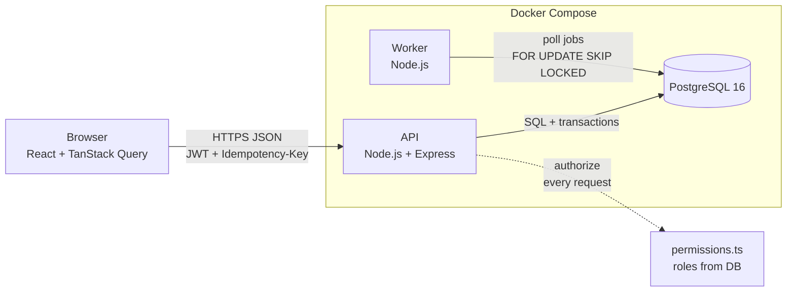
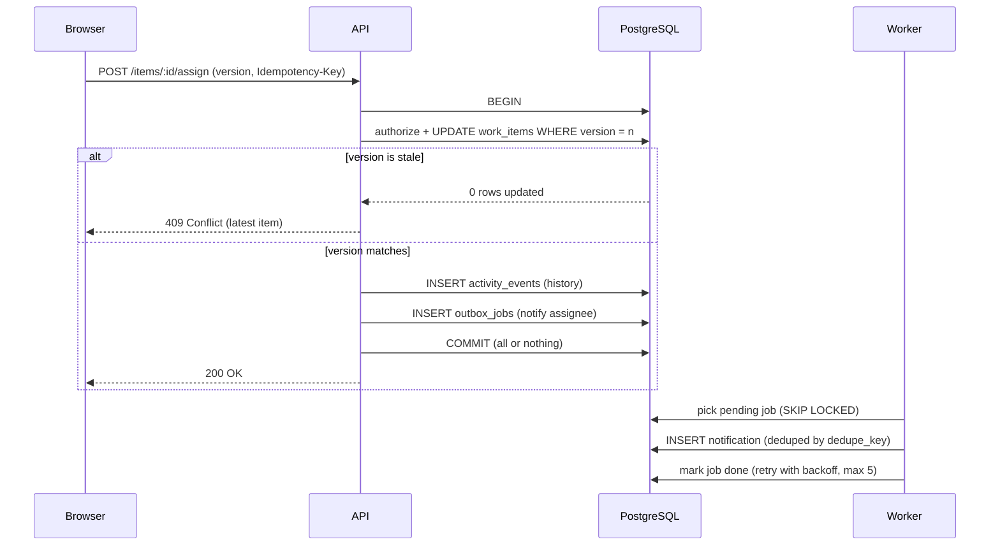

# Operations Under Pressure: internal work item tracker

A web app where teams create, assign, track and resolve operational work items (incidents, customer issues, payment problems, compliance tasks). Built for the Newtonite Software Engineering Challenge.

**Author:** Nimit Raj · Galgotias University · Roll no. 23SCSE1011322

## What it does
- Create work items with a type, priority, description and team.
- Claim an item, assign it, edit it, and move it through a workflow: `open → in_progress → awaiting_approval → resolved → closed`.
- Every change is recorded in a per-item history (who changed what, and when).
- Comments on items.
- A dashboard with attention tiles (assigned to me, unassigned urgent, awaiting my approval), full-text search, status and priority filters, and cursor-based "Load more" pagination.
- Team-based roles: `viewer < member < lead < admin`. Users only see items of their own teams.
- A background worker sends notifications (e.g. assignment, approval needed) without slowing down requests.

## Quick start (one command)
Requirements: **Docker Desktop** (with Docker Compose). Nothing else needs to be installed.

```bash
git clone https://github.com/Nimitraj143/newtonite-ops-23SCSE1011322.git
cd newtonite-ops-23SCSE1011322
docker compose up --build
```

The first build takes a few minutes. On an empty database it creates the tables and loads demo data (11 users, 4 teams, about 5000 work items, about 12,500 history events) automatically.

When the logs show `API listening` and `worker started`, open:

- App: http://localhost:5173
- API health check: http://localhost:4000/health

To reset everything to a fresh database: `docker compose down -v` and then `docker compose up --build`.

Ports used: 5173 (frontend), 4000 (API), 5432 (Postgres). Stop anything else using them first.

## Demo credentials
Every user has the password **`Password123!`**

| Email | Name | Role |
|---|---|---|
| admin@demo.com | Ada Admin | admin in all 4 teams |
| maya@demo.com | Maya Member | member in Payments |
| raj@demo.com | Raj Lead | lead in Payments |
| vik@demo.com | Vik Viewer | viewer in Payments (read only) |
| sana@demo.com | Sana Member | member in Platform |
| leo@demo.com | Leo Lead | lead in Platform |
| ivy@demo.com | Ivy Multi | member in Support, viewer in Compliance |
| omar@demo.com | Omar Lead | lead in Support |
| nina@demo.com | Nina Member | member in Compliance |
| carl@demo.com | Carl Lead | lead in Compliance |
| dev@demo.com | Dev Multi | member in Payments and Platform |

Teams: Payments, Platform, Support, Compliance.

## Things worth trying
1. **Permissions:** log in as `sana@demo.com`; only Platform items are visible. Log in as `vik@demo.com`; no action buttons appear (viewer).
2. **Approval step:** as Maya, move an item to `awaiting approval`. Maya cannot move it further. Log in as `raj@demo.com` (lead) to approve it to `resolved`.
3. **Concurrency:** open the same item in two browser windows. Edit it in window A and save, then edit and save in window B without refreshing. Window B is rejected with a "someone else changed this item" message instead of overwriting window A.
4. **Double click:** create a new item and double-click **Create**. Only one item is created (idempotency key).
5. **Claim race:** two users claiming the same unassigned item at the same moment: exactly one wins, the other gets a 409.
6. **Search and filters:** the filters are kept in the URL, so a filtered view can be bookmarked or shared.

## Running the tests
The automated tests run against a separate database called `ops_test` (they refuse to touch any other database).

```bash
docker compose up -d db          # start only the database
cd backend
npm install
cp .env.example .env             # Windows PowerShell: copy .env.example .env
npm test
```

16 tests cover:
- concurrency: atomic claim (two claimers, one winner), optimistic locking with version conflicts, idempotency keys (same key gives one item, same key with a different body is rejected);
- workflow and authorization: invalid status jumps, only leads/admins can approve, viewers cannot write, users outside a team get 404;
- the background worker: jobs are processed once (deduplicated), retried with backoff, and marked failed after 5 attempts.

## Running without Docker for the app (development)
```bash
docker compose up -d db
cd backend
npm install
cp .env.example .env
npm run migrate        # create tables
npm run seed           # demo data (run once on an empty database)
npm run dev            # API on http://localhost:4000
npm run worker         # in a second terminal: background worker

cd ../frontend         # in a third terminal
npm install
npm run dev            # app on http://localhost:5173
```

## Tech stack
- **Backend:** Node.js, TypeScript, Express 5, PostgreSQL 16 using the `pg` driver (plain SQL, no ORM), zod for validation, JWT and bcrypt for login.
- **Frontend:** React (Vite), TanStack Query, React Router.
- **Tests:** Vitest and Supertest.
- **Infrastructure:** Docker Compose with 4 services (db, api, worker, frontend).

## API overview
| Method | Path | Purpose |
|---|---|---|
| POST | /auth/login | log in, returns a token |
| GET | /auth/me | current user and teams |
| GET | /items | list with filters (`status`, `priority`, `type`, `team_id`, `assignee`, `view`, `q`), cursor pagination (`cursor`, `limit`) |
| GET | /items/summary | counts for the dashboard tiles |
| POST | /items | create (supports `Idempotency-Key` header) |
| GET | /items/:id | item with what the current user is allowed to do |
| PATCH | /items/:id | edit (requires `version`) |
| POST | /items/:id/claim | claim an unassigned item |
| POST | /items/:id/assign | assign or unassign |
| POST | /items/:id/transition | move to another status |
| POST | /items/:id/comments | add a comment (supports `Idempotency-Key`) |
| GET | /items/:id/activity | history of the item |
| GET | /notifications | notifications for the current user |

Authorization is checked on the server for every request (the UI only hides buttons). A user's roles are read from the database on every request, so a role change takes effect immediately.

## Architecture



**What happens on one change** (for example assigning an item):



**Main tables:** `users`, `teams`, `memberships` (user, team, role), `work_items` (with `version`), `activity_events` (append-only history), `idempotency_keys`, `outbox_jobs`, `notifications`.

## Project layout
```
backend/      API, worker, migrations, seed script and tests
  migrations/ SQL schema
  src/        app, auth, permissions, workflow, items, idempotency, worker
  test/       automated tests
frontend/     React app (pages, components, API client)
docker-compose.yml
ENGINEERING_DECISIONS.md   key design decisions and trade-offs
```

See **ENGINEERING_DECISIONS.md** for the reasoning behind the main design choices.

## Known limitations
- The UI has no automated tests; only the backend (concurrency, workflow, authorization, worker) is tested.
- The dashboard and item page refresh by polling (every 15–20 seconds) instead of websockets.
- Assigning from the UI is limited to "assign to me" and "unassign". The API supports assigning to any team member, but there is no user picker yet.
- The notifications list is available in the API but has no page in the UI.
- No optimistic UI updates: buttons wait for the server response.
- The login token is stored in `localStorage` (simple, but not the most secure option), with no refresh tokens or rate limiting.
- Containers run the TypeScript source with `tsx` rather than a compiled production build.
- Demo secrets (`JWT_SECRET` default, database password) are for local use only and must be changed for any real deployment.
- The seed script is meant to be run once on an empty database (Docker does this automatically).